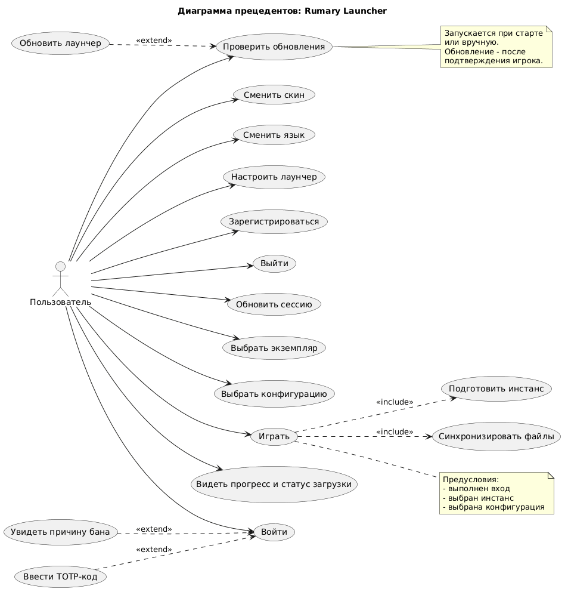

### Словарь

- Minecraft (Майнкрафт) - игра, которую запускается лаунчер.
- Мод (сокращение от модификации) - библиотека, которая модифицирует игру.
- Загрузчик - специальные библиотеки для загрузки игры с модами.
- Майнкрафт Сервер - сервер для многопользовательской игры.
- instance (экземпляр) - это базис файлов для запуска игры. В это понятие входят: сам игра определённой версии (его библиотеки, ассеты и т.д.), загрузчик определённой версии (изначальный, fabric, forge, neoforge и другие).
- config/configuration (конфигурация) - это дополнительные файлы для экземпляра. В это понятие входят по сути любые файлы, которые не нужны для запуска, но нужны для дальнейшей игры: моды, шейдры, текстурпаки и другие.

- Логин - текстовый идентификатор пользователя.
- Никнейм - имя пользователя в игре при запуске через лаунчер.

### Проблема

Владелец нескольких серверов сталкивается с тем, что каждый сервер требует своей версии игры, загрузчика, набора модов и конфигураций:

- игрок вручную собирает и переключает клиенты, ищет и скачивает моды;
- обновление сборки временно «ломает» игроков: у них остаётся старая версия, и вход на сервер невозможен;
- игроки могут добавлять сторонние или изменённые моды;
- у администратора нет единого места для гибкого разграничения прав сотрудников и управления игроками.

### Назначение

Rumary Launcher управляет клиентскими сборками. Администратор описывает сборки и правила доступа в API, а лаунчер приводит клиент игрока в нужное состояние перед запуском.

### Прецеденты

По умолчанию пользователь обладает базовыми правами доступа. Подробнее о правах пользователя описано в работе Rumary API.

#### Прецедент Зарегистрироваться

Экран: Регистрация

Пользователь вводит логин, никнейм и пароль.

После нажатия кнопки "Зарегистрироваться" может произойти 2 случая:

- успешная регистрация → вход в систему
- ошибка во введённых данных → аккаунт пользователю не создаётся.

Ошибки бывают:

- Логин/Никнейм уже существует
- Логин/Никнейм/Пароль слишком короткий/длинный
- Пароль не содержит заглавной буквы, числа или спец. символа
